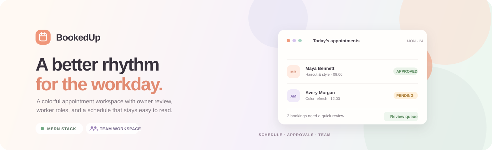
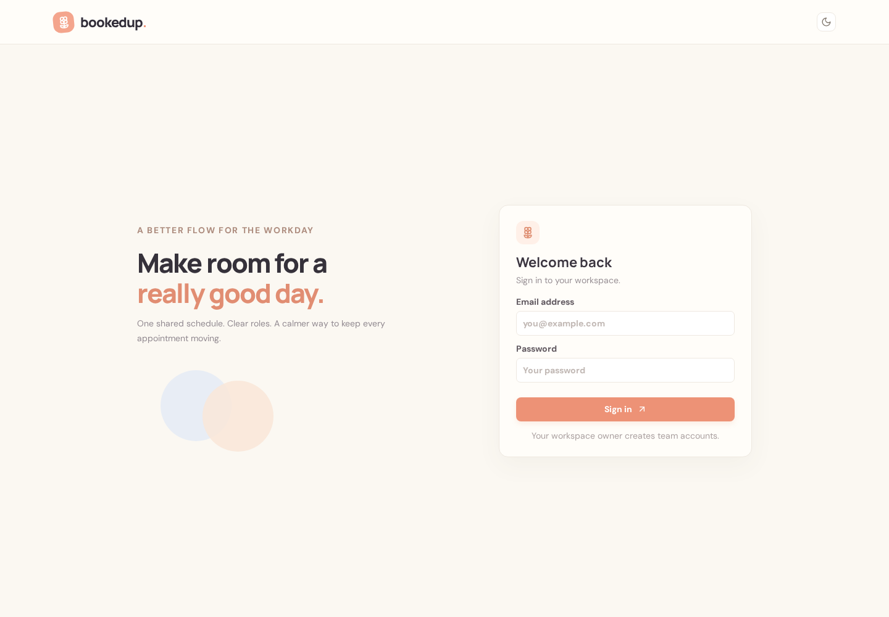
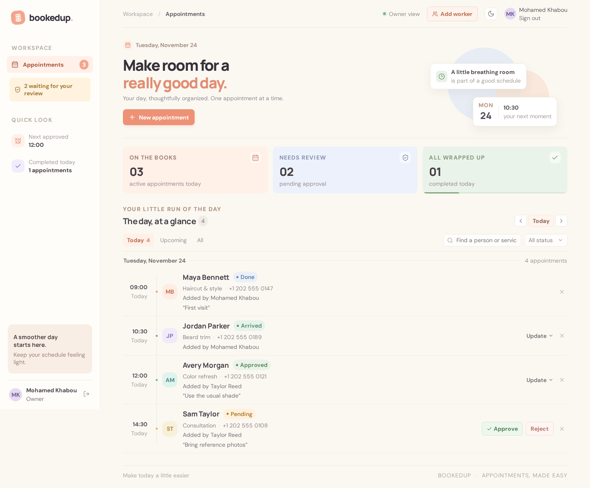
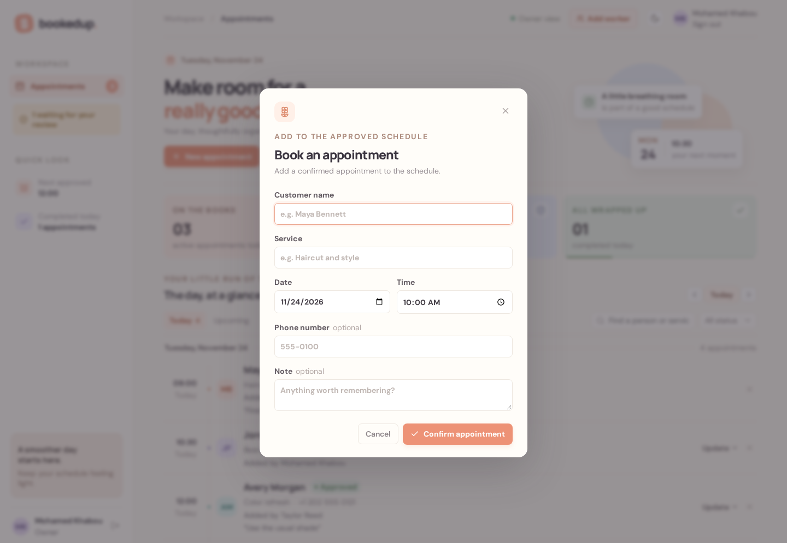

# BookedUp

### Appointments, thoughtfully in order.

A role-aware scheduling workspace for independent service businesses, built with the MERN stack.

**[Live demo](https://bookedup-two.vercel.app/)** · [Explore the screenshots](#screenshots) · [Run locally](#run-it-locally-with-git-bash)

> **Owner-led approvals** · **Worker requests** · **A colorful, responsive schedule**

---

## The product

BookedUp gives a small service business one shared place to manage appointments. Workers can submit bookings for review and move approved visits through the day. The owner reviews pending requests, controls the final appointment status, and can create and manage worker accounts.

The schedule is the center of the experience: bookings are arranged by time, service and customer details stay close at hand, and each item shows who created it and who last updated it. A warm coral, lilac, aqua and green visual system keeps the operational view lively without obscuring the work. Light and dark themes are available and remembered on the device.

## Screenshots

A quick look at the three key views: sign-in, the owner’s schedule, and the appointment form.

### Sign-in


### Owner schedule


### Add an appointment


## Try the live demo

Open [BookedUp](https://bookedup-two.vercel.app/) and sign in with the demo owner account:

- **Email:** [mohamedkhabou@example.com](mailto:mohamedkhabou@example.com)
- **Password:** `MohamedKhabou123`

From the owner workspace, use **Add worker** to create worker accounts and try the worker workflow: sign in as a worker, submit an appointment for review, then return as the owner to approve or reject it. These are shared demo credentials and a shared demo workspace, so changes may be visible to other visitors. Do not reuse this password for any personal account.

## Roles and workflow

| Role | Can do |
|---|---|
| **Owner** | Review and approve or reject pending appointments; change appointment status; delete appointments; create worker accounts; view who added or last updated each appointment. |
| **Worker** | View the shared schedule; submit appointments as pending; move approved appointments to Arrived or Done. |

The owner account is created through a local setup command rather than public registration. The owner creates worker accounts from inside the app. Roles are checked by the API as well as reflected in the interface.

## Core capabilities

- Today, upcoming, and full-schedule views.
- Search by customer, service, or phone; filter by status.
- Appointment states: **Pending**, **Approved**, **Arrived**, **Done**, **Rejected**, and **Cancelled**.
- Daily counts for active appointments, requests awaiting review, and completed visits.
- Appointment records with customer, service, local date and time, optional phone and note.
- Latest activity attribution on each appointment.
- Responsive layout and persistent light/dark themes.

## Built with

| Part | Tools | Role |
|---|---|---|
| Client | React, Vite, Lucide | Role-aware schedule, forms, filters, and theme. |
| API | Node.js, Express | JSON endpoints, authentication, and permission checks. |
| Data | MongoDB, Mongoose | User and appointment persistence with schema validation. |
| Security | bcryptjs, JSON Web Tokens | Password hashing and signed, time-limited sessions. |

## Product and implementation notes

- **Approval is a server-enforced workflow.** A worker-created appointment starts as `Pending`; an owner-created appointment starts as `Approved`. Only an owner can approve/reject requests or delete appointments. Workers can advance approved visits to `Arrived` or `Done`.
- **The app is scoped to one shared business workspace.** Users in that workspace see its shared schedule. Multi-business tenancy, customer-facing bookings, and public sign-up are not included.
- **Each record stores its creator and latest updater.** The schedule can show who entered a booking and who last changed its state. This is a lightweight activity trace, not a full event-by-event audit log.
- **Dates and times are local business values** stored as `YYYY-MM-DD` and `HH:mm`, avoiding silent timezone conversion of the entered appointment time.

## Run it locally with Git Bash

This walkthrough is for Windows with **Git Bash**. It also works in another terminal with equivalent commands.

### Before you start

Install:

- [Node.js LTS](https://nodejs.org/) (20 or newer; npm is included).
- [Git for Windows](https://git-scm.com/download/win), which includes Git Bash.
- [MongoDB Community Server](https://www.mongodb.com/try/download/community) for a local database.

Check the tools from Git Bash:

```bash
node --version
npm --version
git --version
```

### 1. Get the project files

**If you downloaded the ZIP:** extract it, then open Git Bash in the extracted `BookedUp` folder—the folder that contains `package.json`. In Git Bash, a Windows path such as `C:\Users\Alex\Downloads\BookedUp` is written like this:

```bash
cd /c/Users/Alex/Downloads/BookedUp
```

Replace `Alex` with your Windows account folder name. Tip: in File Explorer, open the extracted folder, right-click an empty area, and choose **Open Git Bash here**.

**If the project is hosted on GitHub:** use GitHub’s **Fork** button to create your own copy, then clone the fork URL shown on GitHub:

```bash
git clone https://github.com/YOUR-USERNAME/BookedUp.git
cd BookedUp
```

Forking is only available after a repository is hosted on GitHub. A downloaded ZIP is already a local copy, so you can run it without forking or cloning.

### 2. Start MongoDB locally

Install MongoDB Community Server and make sure its Windows service is running. You can check this in the Windows **Services** app by looking for the MongoDB Server service. BookedUp connects to this local database by default:

```text
mongodb://127.0.0.1:27017/bookedup
```

### 3. Create your environment file

From the project root in Git Bash:

```bash
cp server/.env.example server/.env
notepad server/.env
```

Set the values in `server/.env`:

```env
PORT=5000
MONGODB_URI=mongodb://127.0.0.1:27017/bookedup
JWT_SECRET=paste-a-long-random-secret-here
```

Generate a local signing secret with Node, then paste its output after `JWT_SECRET=`:

```bash
node -e "console.log(require('node:crypto').randomBytes(32).toString('hex'))"
```

Save the file and close Notepad. `.env` is ignored by Git; do not commit database passwords or signing secrets.

### 4. Install the project dependencies

Run this once from the project root:

```bash
npm run install:all
```

### 5. Create the first owner account

With MongoDB running and the environment file saved, run:

```bash
npm run create-owner
```

Enter the owner’s name, email, and password when prompted. The setup command will not create a second owner account. After signing in, the owner can use **Add worker** in the app to create a worker login.

### 6. Add optional demo appointments

To load the sample schedule:

```bash
npm run seed
```

This replaces the appointment records with sample appointments but leaves user accounts intact. Skip this step if you want to start with an empty schedule.

### 7. Start the client and API

```bash
npm run dev
```

Keep this Git Bash window open. The command starts both services:

| Service | Local address |
|---|---|
| React app (Vite) | [http://localhost:5173](http://localhost:5173) |
| Express API | [http://localhost:5000/api](http://localhost:5000/api) |

Open **http://localhost:5173** and sign in with the owner account.

### Quick role-based demo

1. Sign in as the owner and choose **Add worker**. Create a worker account with a temporary password.
2. Sign out, then sign in with the worker account.
3. Add an appointment. It appears as **Pending** for owner review.
4. Sign back in as the owner and approve or reject the pending request.
5. Sign in as the worker again and move an approved appointment to **Arrived** or **Done**.

### Useful development commands

Run these from the project root:

| Command | Use |
|---|---|
| `npm run dev` | Start the client and API together. |
| `npm run create-owner` | Create the initial owner account. |
| `npm run seed` | Replace appointment records with the sample schedule. |
| `npm run build` | Build the React client. |
| `npm start` | Start the Express API without the development watcher. |

### Common local issues

- **MongoDB connection refused:** start the MongoDB Windows service and confirm the local URI in `server/.env`.
- **The page opens but the API is unavailable:** keep `npm run dev` running and check the terminal for an API or database error.
- **Port 5000 or 5173 is already in use:** stop the other process before starting BookedUp.
- **Forgot the owner password:** there is no public password reset in this version; for a local demo, reset the account in your development database or create a fresh local database.

## API surface

All routes are served under `/api` and return JSON. Appointment routes require a valid bearer token.

| Method | Route | Access | Purpose |
|---|---|---|---|
| `GET` | `/api/health` | Public | API health check. |
| `POST` | `/api/auth/login` | Public | Sign in and receive a signed token. |
| `GET` | `/api/auth/me` | Signed in | Return the current account. |
| `POST` | `/api/auth/workers` | Owner | Create a worker account. |
| `GET` | `/api/appointments` | Signed in | List appointments, optionally filtered by date or status. |
| `POST` | `/api/appointments` | Signed in | Create a request (worker) or confirmed appointment (owner). |
| `PATCH` | `/api/appointments/:id` | Owner / limited worker | Change status subject to role rules. |
| `DELETE` | `/api/appointments/:id` | Owner | Delete an appointment. |

## Repository map

```text
BookedUp/
├── client/                         React and Vite frontend
│   ├── index.html                  HTML entry document
│   ├── package.json                Frontend scripts and dependencies
│   ├── package-lock.json           Locked frontend dependencies
│   ├── vite.config.js              Dev server and API proxy configuration
│   └── src/
│       ├── App.jsx                 Session, schedule state, and API interactions
│       ├── main.jsx                React application entry point
│       ├── style.css               Layout, color system, themes, and responsive styles
│       ├── utils.js                Shared date and display helpers
│       └── components/
│           ├── AppointmentCard.jsx Owner/worker appointment actions
│           ├── AppointmentModal.jsx Appointment entry form
│           ├── LoginScreen.jsx     Sign-in screen
│           └── WorkerModal.jsx     Owner-only worker account form
├── server/                         Express and MongoDB backend
│   ├── .env.example                Environment variable template
│   ├── package.json                Backend scripts and dependencies
│   ├── package-lock.json           Locked backend dependencies
│   └── src/
│       ├── server.js               REST API, authentication, and role permissions
│       ├── createOwner.js           First-owner account setup
│       ├── seed.js                  Sample appointment data
│       ├── middleware/
│       │   └── auth.js              JWT verification and owner-only guard
│       └── models/
│           ├── Appointment.js       Appointment schema and actor references
│           └── User.js              Account, password hash, and role schema
├── screenshots/                    README screenshots for each app view
├── .gitignore                      Ignores secrets, dependencies, and build output
├── package.json                    Root development and utility scripts
├── package-lock.json               Locked root dependencies
└── README.md                       Project overview, screenshots, and setup
```

## Next steps

Natural extensions include a full activity history, per-day availability and booking limits, appointment editing, multiple business workspaces, and customer-facing booking links. The current implementation keeps permissions and approval focused on one shared workspace.
